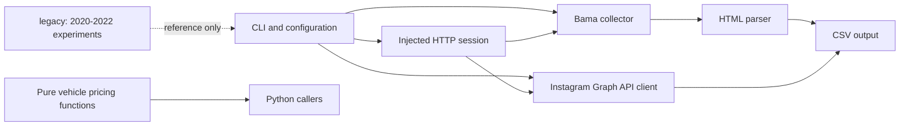

# Current architecture

The repository is a small set of local, read-only collectors and deterministic pricing helpers, not a long-running service.

The CLI is the composition root: it parses commands, loads environment-dependent Meta settings, constructs the session and injects dependencies. The automotive parser does not change source prices. The Instagram adapter builds versioned API requests, follows bounded cursor pagination, and leaves metric selection to callers.

The old notebooks, binary image snapshots and archived Selenium exercises remain independent of the maintained package. No live deployment, scheduler, queue or database is known.
